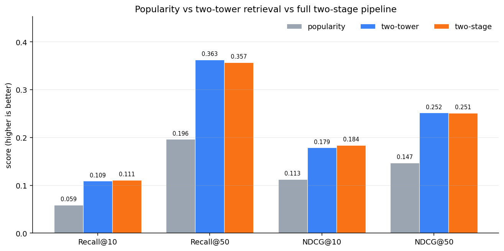
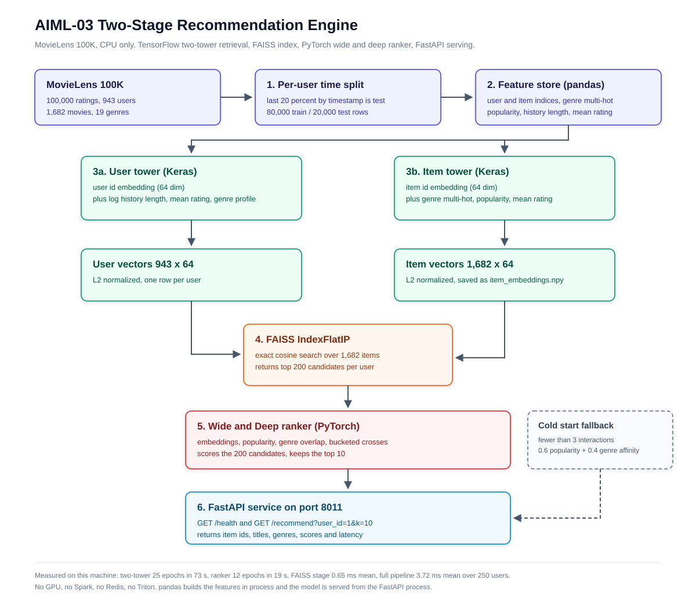
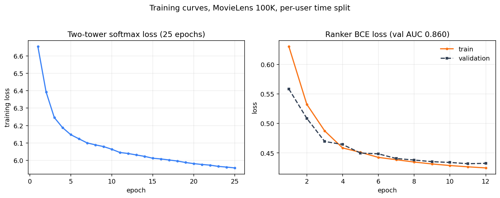

# AIML-03: Large-Scale Personalized Recommendation Engine

A two-stage recommender on MovieLens 100K. Stage one is a two-tower retrieval
model that turns every user and every movie into a 64 dimensional vector and
uses FAISS to pull 200 candidates out of the catalog in under a millisecond.
Stage two is a wide and deep ranker that re-scores those 200 candidates and
returns the top 10. A FastAPI service exposes both stages on port 8011.

Everything in this README was measured on the machine that built it: Windows 11,
CPU only, Python 3.12, no GPU, no Spark, no Redis, no Triton, no Airflow.

## Results

Held out test set: 20,000 interactions from 943 users. Seen items are masked
before scoring, so no system is credited for recommending something the user
already watched.

| System | Recall@10 | Recall@50 | NDCG@10 | NDCG@50 |
|---|---|---|---|---|
| Popularity baseline | 0.0587 | 0.1963 | 0.1128 | 0.1469 |
| Two-tower retrieval alone | 0.1089 | 0.3625 | 0.1787 | 0.2518 |
| Full two-stage pipeline | **0.1111** | 0.3569 | **0.1837** | 0.2511 |

Relative to popularity, the two-tower lifts Recall@10 by 85.6 percent, Recall@50
by 84.7 percent, NDCG@10 by 58.4 percent and NDCG@50 by 71.4 percent.

These are the numbers from the run recorded in `results/metrics.json`. A fresh
retrain on CPU can move the third decimal because TensorFlow and PyTorch do not
guarantee bitwise identical reductions, so compare against the committed JSON
rather than against a new run.


The ranker is a smaller and more mixed story, and it is worth being precise
about it: it improves the head of the list (Recall@10 +2.0 percent, NDCG@10
+2.8 percent relative to retrieval alone) and is flat to slightly negative at
50 (Recall@50 -1.5 percent, NDCG@50 -0.3 percent). The reason is in
[Limitations](#honest-limitations-and-substitutions): MovieLens has no
impression log, so the ranker is trained pointwise on interaction positives and
sampled negatives rather than on real "shown but not clicked" labels. It learns
a little about popularity and genre fit on top of the retrieval score and not
much more. I tried a listwise softmax objective and a score blend as well; both
landed inside the same noise band (listwise: Recall@10 0.1099, NDCG@10 0.1835,
Recall@50 0.3537, NDCG@50 0.2494), so the simpler pointwise model is the one
that ships.

Stage two cannot exceed its candidate set: the 200 candidates contain 59.85
percent of all test interactions, which is the ceiling for the ranker.



## Dataset and the exact split

MovieLens 100K, downloaded from
`https://files.grouplens.org/datasets/movielens/ml-100k.zip`.

- 100,000 ratings, 943 users, 1,682 movies, 19 genres
- every rating row is treated as an implicit positive interaction, including
  low ratings; the rating value is kept as a feature, not as a label

The split is per user, by time:

1. Sort each user's interactions by timestamp ascending.
2. The last `round(0.20 * n)` interactions become test, with a minimum of 1.
3. Everything before that becomes train.

That gives exactly 80,000 train rows and 20,000 test rows (20.0 percent).

Exact cutoffs from `data/processed/split_stats.json`:

| Quantity | Value |
|---|---|
| Global max train timestamp | 1998-04-22 23:10:38 UTC (`893286638`) |
| Global min test timestamp | 1997-09-20 20:18:15 UTC (`874786695`) |
| Train rows per user | min 16, median 52, max 590 |
| Test rows per user | min 4, max 147 |

Because the split is per user, the global train and test timestamp ranges
overlap: a quiet user's test rows can be older than a very active user's train
rows. Within any single user, every test row is strictly later than that user's
train rows. This is the standard leave-last-n-out protocol and it is what the
brief asks for, but it is not a global time cutoff and the README should not
pretend otherwise.

71 of the 1,682 movies have zero training interactions (they only appear in
test). They stay in the catalog. Their id embedding is untrained, so the item
tower has to carry them with genre and popularity features. That is a real
cold-item condition, not a bug.

## Architecture



The same flow as text:

```
MovieLens 100K
   -> per-user time split (80k train / 20k test)
   -> FeatureStore (pandas): indices, 19 genre multi-hot, popularity, history stats
   -> two-tower (TensorFlow/Keras, 64 dim, softmax over the full catalog)
   -> item_embeddings.npy (1682 x 64, L2 normalized) -> FAISS IndexFlatIP
   -> top 200 candidates per user (seen items masked)
   -> wide and deep ranker (PyTorch) -> top 10
   -> FastAPI GET /recommend
```

## Features

All features are computed on train only. Nothing from the test split leaks into
a feature.

| Feature | Shape | Notes |
|---|---|---|
| user index, item index | 943, 1682 | contiguous ids for the embedding tables |
| genre multi-hot | 1682 x 19 | straight from `u.item` |
| item popularity | 1682 | train interaction count plus percentile rank |
| item rating stats | 1682 x 2 | mean rating and rating count |
| user history length | 943 | log scaled for the tower |
| user mean rating | 943 | divided by 5 |
| user genre profile | 943 x 19 | L1 normalized sum of the genres the user watched |

Built in pandas, in one process. This replaces the Spark job the brief implies.
See the limitations section.

## Models

### Two-tower retrieval (TensorFlow / Keras)

- User tower: user id embedding (64) + dense block over log history length,
  mean rating and the 19 dim genre profile, concatenated and projected to 64,
  then L2 normalized.
- Item tower: item id embedding (64) + dense block over genre multi-hot,
  log popularity, popularity percentile, mean rating and genre count,
  projected to 64, then L2 normalized.
- Objective: softmax over all 1,682 items with cosine logits divided by
  temperature 0.1. This is sampled softmax with the entire catalog as the
  sample, which is affordable at this catalog size and removes the false
  negative problem of in-batch negatives.
- 25 epochs, batch 1,024, Adam at 0.01, 80,000 pairs per epoch.
- Train time 72.65 s on CPU. Loss 6.6545 (epoch 1) to 5.9560 (epoch 25).



### Wide and deep ranker (PyTorch)

- Input: the frozen user and item vectors, their dot product, log popularity,
  popularity percentile, item mean rating, log rating count, log history
  length, user mean rating, genre cosine, genre count, rating gap,
  popularity x genre and history x genre crosses.
- Wide part: a linear term over those features plus two bucketed cross
  embeddings (popularity bucket x genre bucket, dot bucket x history bucket).
- Deep part: 256 -> 64 -> 1 MLP with dropout 0.1.
- Training rows: 72,980 mined per user from train (25,830 positives, 47,150
  hard and random negatives). Hard negatives are the top retrieved items the
  user has not seen.
- 12 epochs, Adam at 1e-3, BCE loss, 65,690 train rows and 7,290 validation
  rows split by user. Validation AUC 0.8600. Train time 19.05 s.

### FAISS

`IndexFlatIP` over 1,682 L2-normalized 64 dim vectors, so inner product is
cosine similarity. Exact search. At this catalog size an approximate index
would only trade recall for a latency win nobody can measure.

## Evaluation

- Relevance is binary: a test interaction is relevant, nothing else is.
- Before scoring, each user's train items are removed from the ranking. The
  two-stage system filters them after FAISS search and re-fetches enough
  candidates to still hand 200 to the ranker (200 + that user's history length,
  then mask, then slice).
- Recall@K = hits in the top K / number of test items for that user.
- NDCG@K uses binary gains and the ideal DCG over `min(n_relevant, K)` slots.
- Averages are over the 943 users that have at least one test item (all of them).
- Numbers live in `results/metrics.json`. Nothing is hardcoded in the docs.

## Cold start

Rule: a user with fewer than 3 training interactions, or a user id that is not
in the training data at all, takes the fallback path. The fallback scores the
catalog with `0.6 * normalized popularity + 0.4 * genre affinity to the seed
items`. With no seed items it is pure popularity.

How many real users hit it: **0 of 943**. The minimum training history in this
dataset is 16 interactions, so nobody in MovieLens 100K is actually cold under
this rule. Reporting that honestly is more useful than pretending the branch
was exercised.

To still measure the branch, `src/evaluate.py` runs a simulation: 60 users get a
2 item seed profile (their two most recent training items) and are scored on
their real test items, with only the seed items excluded. The fallback never
reads a user id or a user embedding, so this is the same code path a brand new
user hits.

| Cold-start scoring, 60 simulated users | Recall@10 | Recall@50 | NDCG@10 | NDCG@50 |
|---|---|---|---|---|
| 0.6 popularity + 0.4 genre affinity | 0.0368 | 0.1420 | 0.0590 | 0.0979 |
| Popularity only, same users | 0.0339 | 0.1252 | 0.0590 | 0.0900 |

Genre affinity adds a little recall at both cutoffs and does not move NDCG@10.
The HTTP path for `user_id=999999` returns the popularity fallback, which is
captured in `results/api_response_cold.json`.

## Serving

```
C:/Python312/python.exe -m uvicorn src.serve:app --host 127.0.0.1 --port 8011
```

Endpoints:

- `GET /health` returns index size, embedding dimension, cold-start threshold.
- `GET /recommend?user_id=1&k=10` returns ranked items with title, genres,
  score and the server side latency.

`k` is validated to 1..50; `k=51` returns HTTP 422.

Real captured response (`results/api_response.json`, HTTP 200, warm request,
trimmed to the first 3 of 10 recommendations for readability; the file has all
10):

```json
{
  "user_id": 1,
  "k": 10,
  "cold_start": false,
  "strategy": "two_stage_faiss_ranker",
  "history_length": 218,
  "n_candidates": 200,
  "latency_ms": 8.159,
  "recommendations": [
    {"rank": 1, "item_id": 222, "title": "Star Trek: First Contact (1996)",
     "genres": ["Action", "Adventure", "Sci-Fi"], "score": 0.845366},
    {"rank": 2, "item_id": 100, "title": "Fargo (1996)",
     "genres": ["Crime", "Drama", "Thriller"], "score": 0.824011},
    {"rank": 3, "item_id": 258, "title": "Contact (1997)",
     "genres": ["Drama", "Sci-Fi"], "score": 0.758341}
  ]
}
```

The first request after startup took 54.588 ms because of lazy allocation in
FAISS and torch; after that it settles. The file above is a warm call and is
the exact body curl received. `results/api_response_first_call.json` keeps the
cold first call so the 54.588 ms is not quietly dropped.

`results/api_health.json`:

```json
{"status":"ok","users":943,"items":1682,"faiss_vectors":1682,
 "faiss_index":"IndexFlatIP","embedding_dim":64,"retrieval_k":200,
 "cold_start_threshold":3,"ranker":"wide_and_deep_mlp"}
```

## Latency

250 users, sequential, single process, CPU only. Stage 1 is FAISS search plus
masking plus the slice to 200 candidates. Stage 2 is ranker scoring of those
200 plus the top 10 sort. Full pipeline is `RecommenderService.recommend`,
which is the exact object FastAPI serves from.

| Stage | Mean | p50 | p95 |
|---|---|---|---|
| Stage 1, retrieval | 0.653 ms | 0.572 ms | 1.219 ms |
| Stage 2, ranking | 2.890 ms | 2.517 ms | 5.488 ms |
| Full pipeline | 3.723 ms | 3.415 ms | 5.893 ms |

Raw numbers in `results/latency.json`. Over HTTP, 20 warm sequential requests
to `GET /recommend?user_id=7&k=10` gave mean 4.068 ms, median 3.842 ms, max
6.698 ms (`results/api_latency_http.json`).

## How to run

```bash
cd C:/Users/suhai/Documents/Codex/2026-09-20/lo/nexvia-capstones/AIML-03

# one shot: data, features, both models, FAISS, evaluation, latency, plots, tests
C:/Python312/python.exe run_all.py

# or step by step
C:/Python312/python.exe src/data_prep.py     # downloads ml-100k, splits by time
C:/Python312/python.exe src/features.py      # pandas feature store
C:/Python312/python.exe src/two_tower.py     # trains and saves both towers
C:/Python312/python.exe src/faiss_index.py   # builds artifacts/item_index.faiss
C:/Python312/python.exe src/ranker.py        # trains the wide and deep ranker
C:/Python312/python.exe src/evaluate.py      # writes results/metrics.json
C:/Python312/python.exe src/latency.py       # writes results/latency.json
C:/Python312/python.exe src/plots.py         # writes the two PNGs

# service
C:/Python312/python.exe -m uvicorn src.serve:app --host 127.0.0.1 --port 8011
curl "http://127.0.0.1:8011/health"
curl "http://127.0.0.1:8011/recommend?user_id=1&k=10"

# tests (need the artifacts from the training steps)
C:/Python312/python.exe -m pytest tests/ -v
```

`data/` and `artifacts/` are gitignored because they are reproducible from the
scripts. `results/` is committed because those are the numbers this README
quotes.

## Repository layout

```
AIML-03/
  run_all.py              runs every step in order, then pytest
  requirements.txt
  src/
    config.py             every constant that affects a reported number
    data_prep.py          download, parse, per-user time split
    features.py           pandas feature store, saved to artifacts/features.npz
    two_tower.py          Keras towers, full-catalog softmax, saves embeddings
    faiss_index.py        IndexFlatIP build, save, search
    ranker.py             PyTorch wide and deep ranker plus hard negative mining
    cold_start.py         popularity plus genre affinity fallback
    metrics.py            Recall@K, NDCG@K, top-k helpers
    evaluate.py           three systems plus the cold-start simulation
    latency.py            stage 1, stage 2 and full pipeline timings
    plots.py              training curves and metric bars
    recommender.py        one serving code path used by API, latency and tests
    serve.py              FastAPI app
  tests/test_pipeline.py  8 assertions over the real artifacts
  results/                metrics.json, latency.json, api_response.json, PNGs
  docs/                   architecture.svg, presentation.md, reflection.md
```

## Tests

```
C:/Python312/python.exe -m pytest tests/ -v
...
8 passed, 1 warning in 20.02s
```

The warning is a numpy deprecation inside the `faiss` loader, not project code.
What the tests assert:

1. every required artifact exists
2. FAISS index size equals the item count (1,682)
3. user and item vectors are unit norm
4. retrieval returns exactly k unique ids, sorted by score
5. a brand new user id gets the popularity fallback and the globally most
   popular training item at rank 1
6. a known user gets 10 unique, unseen items scored in 0..1
7. all four metrics for all three systems are in 0..1 and the two-tower beats
   popularity on NDCG@10
8. the cold-start report is internally consistent

## Honest limitations and substitutions

- **pandas instead of Spark.** The brief implies a distributed pipeline. Spark
  is not installed here and there is no cluster, so feature engineering runs in
  one pandas process over 80,000 rows. That is the right tool at this size and
  it is not what a 100M interaction pipeline would look like.
- **In-process dictionaries instead of Redis.** Seen-item sets and recent-item
  seeds are Python dicts built at startup from `train.csv`. There is no Redis.
  This works for one process and would not survive multiple workers or a
  restart-free feature update.
- **Plain scripts instead of Airflow.** `run_all.py` is a sequential runner with
  fail-fast behaviour. There is no scheduler, no retries, no lineage, and no
  Airflow.
- **FastAPI instead of Triton.** The model is loaded in the API process and
  scored on the request thread. There is no Triton, no batching server, no
  separate inference service.
- **No GPU.** TensorFlow and PyTorch both run on CPU. Training the two-tower
  takes 73 s and the ranker 19 s, which is why 25 and 12 epochs were enough.
- **No click-through.** MovieLens has no impression log, so CTR cannot be
  computed honestly. Recall@K and NDCG@K are the metrics that this data
  supports. The assignment mentions click-through; the correct answer here is
  that the dataset does not contain the negatives an impression log would have.
- **Ranker supervision is pointwise, not from impressions.** Positives are train
  interactions, negatives are hard negatives from FAISS plus random catalog
  items. This is why the ranker's gain is small and only at the head of the
  list. A listwise objective was tested and did not change the picture.
- **Per-user time split, not a global cut.** Global train and test timestamp
  ranges overlap. Every user's own test rows are later than their own train
  rows.
- **Cold start is simulated.** 0 of 943 real users are cold; the fallback is
  measured on 60 users given a 2 item seed profile. That is a simulation, not
  observed cold traffic.
- **Exact FAISS, one catalog snapshot.** No IVF, no HNSW, no incremental
  updates, no retraining loop. The index is rebuilt from scratch when the
  pipeline runs.
- **71 items are cold in the item sense.** They have no training interactions
  and rely on genre and popularity features through the item tower.
- **Scale.** 100,000 interactions is a teaching scale. At production scale the
  same shape would need distributed feature generation, an ANN index with
  sharding, a feature store, negative sampling from impressions, and online
  metric monitoring. None of that is claimed here.

## Next steps

1. Get impression logs, even synthetic ones, so the ranker can learn from
   "shown but not clicked" instead of sampled negatives. That is the single
   biggest gap.
2. Nested temporal validation inside train for ranker supervision and early
   stopping, instead of reusing train positives the retriever already memorized.
3. Approximate FAISS (IVF-PQ or HNSW) once the catalog is large enough that
   exact search actually costs something, and measure the recall loss.
4. Feature store and offline/online parity: the same feature code should serve
   training and requests.
5. Add a session based user tower that embeds the last N items, so a user with
   two clicks gets a real vector instead of the popularity fallback.
6. Online evaluation: CTR, dwell time, and a holdback group, which is the only
   way to know whether any of this offline gain survives contact with users.
